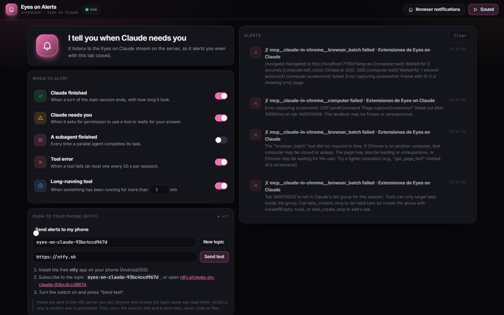

# Eyes on Alerts

**An [Eyes on Claude](https://github.com/dfadify-web/eyes-on-claude) extension.** Get alerted when Claude finishes, needs your permission, a tool fails or runs too long: browser notification, sound, and push to your phone with ntfy.

[Español](README.es.md)



## What it does

- Runs on the server (autostart), so it alerts even with the tab closed.
- Rules: turn finished (with duration), Claude needs you, subagent finished, tool error, long-running tool (N min).
- Push to your phone through ntfy (random private topic, any ntfy server), with a test button.
- Browser notifications and a synthesized chime.

Everything comes from the real Eyes on Claude stream (Claude Code transcripts): nothing is guessed.

## Install

Requires Eyes on Claude **v2.3+** and Node 18+.

```bash
npx -y github:dfadify-web/eyes-on-alerts
```

Open Eyes on Claude → **Extensions** → **Eyes on Alerts** (`http://localhost:7777/#ext/eyes-on-alerts`). Uninstall with `npx -y github:dfadify-web/eyes-on-alerts --uninstall`.

Standalone: `node server.js` → `http://localhost:7782` (needs Eyes on Claude running on :7777).

## Push to your phone

1. Install the free **ntfy** app (Android / iOS).
2. Subscribe to the topic shown in the extension (a random one is generated for you).
3. Turn on "Send alerts to my phone" and press **Send test**.

Alerts go to the ntfy server you choose (default `https://ntfy.sh`, or your own). Anyone who knows the topic can read them; they only carry the session title and a short text. Settings live in `~/.claude/eyes-on-claude/eyes-on-alerts.json`.

## How it works

A zero-dependency Node server (`server.js`) serves `public/` and proxies Eyes on Claude's live `/events` stream; `plugin.js` also follows that stream on the server to fire alerts. It only listens on 127.0.0.1.

MIT © dfadify-web
